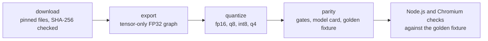

# Architecture

The exporter turns a pinned MoEdernColBERT checkpoint into a self-describing upload folder of ONNX
graphs and proves each graph before it ships. This page explains the design choices, the checks
that back them, and how to operate, secure and reproduce the build.

## Pipeline

Each model goes through the same five steps; `moedern-onnx build --model <slug>` runs the first four.

- **download** (`source.py`) fetches the files of one Hugging Face revision and rejects any byte
  sequence whose SHA-256 differs from the hash pinned in `ModelSpec.files`.
- **export** (`exporting.py`, `portable.py`) re-implements the model with plain tensor operations
  and writes `model_fp32.onnx`, the effective tokenizer and `runtime.json`.
- **quantize** (`quantization.py`) derives the other precisions from the FP32 graph.
- **parity** (`validation.py`) compares FP32 with upstream PyTorch and every other precision with
  FP32, applies the gates in `contracts.py`, and writes the report, the model card (`card.py`) and a
  golden fixture for the JavaScript runtimes.
- `scripts/verify-node.mjs` and `scripts/verify-browser.mjs` replay that fixture in onnxruntime-node
  and in ONNX Runtime Web inside Chromium.

`ModelSpec` in `source.py` is the one place that names a model: upstream ID, revision, pinned file
hashes, target repository and shipped precisions. Paths, the manifest and the model card derive
from it.

## Why a re-implemented graph

The upstream checkpoint ships custom Python code (`modeling_modernbert_hash_moe_v10.py`) that picks
between a dense, a grouped and a Triton mixture-of-experts path at run time, depending on batch
size and hardware. Exporting that code directly would bake one data-dependent path into the graph
and would need `trust_remote_code` wherever the model loads. `portable.py` instead evaluates every
routed expert and weights the outputs with the learned top-k gates, which is the dense path written
as tensor operations. The graph needs no custom operators and no Python at inference time.

VERIFIED: the FP32 graphs match upstream within 1.0e-6 (1.5M) and 8.6e-7 (27M) per value. For the
27M model, a batch of three 512-token sequences exceeds 1,220 tokens and takes upstream's grouped
path; the graph matches that path within the same bound.

The cost is compute: the graph runs all eight experts per token instead of two. `check_architecture`
rejects checkpoints with layers the graph does not implement (convolutions, other layer kinds, more
than one shared expert, more than 512 positions).

## Precision contracts

Every precision has a contract in `contracts.py`. The exporter writes it into `manifest.json`, the
parity fixture and the model card, so the JavaScript harness reads the thresholds instead of
declaring its own.

- **exact** (fp32, q8, q4): every runtime must reproduce the Python ONNX Runtime token vectors within
  1e-4 per value and every MaxSim score within 1e-3, with the same top-1 passage.
- **quality** (fp16, int8): every runtime is compared with its own FP32 output. The gate is a mean
  token cosine of at least 0.98 (0.999 for fp16), the same top-1 passage for at least 95 % of queries
  and a top-5 overlap of at least 0.90.
- Every quantized precision must also pass the quality gate against FP32 in Python.

VERIFIED: the quality contract exists because fp16 and dynamic int8 kernels differ between runtimes.
In the probe that motivated it, onnxruntime-node 1.21.0 and ONNX Runtime Web 1.30.0 produced fp16 token
vectors up to 0.066 and int8 vectors up to 0.152 away from Python's ONNX Runtime 1.31.1, across both
models, while each still passed the gate against its own FP32 output. The fp32, q8 and q4 graphs
stayed within 1.1e-6 in the same runtimes.

A token matrix's fingerprint is `revision:graphSha256`; for a quality graph it also names the runtime
(for example `onnxruntime-web@1.30.0/wasm`). `maxSim` refuses to compare matrices with different
fingerprints, which keeps caches from mixing runtime-specific vectors.

## Variant design

- **q8** stores per-output-channel INT8 weights and dequantizes them with explicit Cast and Mul nodes,
  so the math stays FP32 and ONNX Runtime does not rewrite the weights into MatMulNBits kernels.
  VERIFIED: q8 vectors match across Python, Node.js and WASM within 1.1e-6. q8 shrinks the download;
  it does not speed up inference or reduce memory.
- **int8** uses `quantize_dynamic`: INT8 weights and UINT8 activations quantized per batch. A
  passage's vectors therefore depend slightly on the other passages in its batch.
- **q4** uses `MatMulNBitsQuantizer` with symmetric 4-bit blocks of 32 weights.
- **fp16** uses ONNX Runtime's float16 converter with FP32 inputs and outputs. The converter keeps
  TopK in FP32 and appends its Cast nodes out of order, so the graph is sorted topologically again.
- All quantized variants store the token table as row-wise INT8 and gather rows before dequantizing,
  and none of them quantizes the router: a small router error can change which experts run.

## Integration with defuss-vectorsearch

The encoders produce a variable number of 128-dimensional vectors per passage, in a space unrelated
to dense embedding models such as Winzling. The intended use is a reranking stage: a dense index
finds candidates, MoEdernColBERT reorders them by MaxSim.

- Cache document token matrices keyed by `encoder.fingerprint`, the content hash and the chunking
  policy. A 256-token document needs 128 KiB of vectors.
- Reranking cannot recover a relevant passage that the dense stage did not return; measure the
  candidate recall separately from the reranked quality.

## Operations

- `make setup` installs locked dependencies, Chromium and both upload folders; `make verify` runs
  lint, tests, coverage and the end-to-end build, as CI does.
- `make start` serves the built demo with `vite preview`, writing its PID to `tmp/demo.pid` and its
  output to `var/log/demo.*`; `make stop` ends it with SIGTERM.
- The 27M folders need about 240 MB of disk per copy; `make e2e` also copies them into the demo build.

### Reproducibility

VERIFIED: exporting the same pinned checkpoint on macOS (arm64) and Linux (x86-64) produced graphs with
identical nodes and initializer names whose RoPE tables differed by one unit in the last place
(6e-8). Graph hashes therefore depend on the build platform. Upload a folder exactly as one build
wrote it, because its manifest, parity report, model card and golden fixture all name those hashes.

## Security

- Upstream files are pinned by SHA-256 in code, not by a manifest written on first download.
- `trust_remote_code` runs only at export and parity time, on hash-verified local files, with
  `local_files_only`; inference loads no Python model code.
- The JavaScript loaders check every file's size and SHA-256 against `manifest.json` before creating
  an ONNX Runtime session, and accept only plain file names.

## Privacy

Inference runs entirely on the user's device. The demo serves the models, tokenizer and WASM runtime
from its own origin and sends no text to any server.
